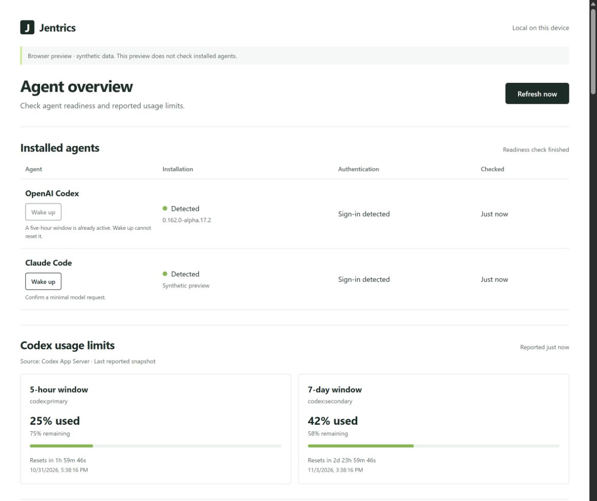

# Jentrics

**[Download the Windows alpha](https://github.com/jknggg/Jentrics/releases/tag/v0.1.0-alpha.1)** · [Report a bug](https://github.com/jknggg/Jentrics/issues/new/choose)

A local Windows tray app for Claude Code and OpenAI Codex readiness, reported usage limits, and usage history. Automatic checks send no model requests. No Jentrics account or remote backend is required.

Jentrics starts in the tray, checks supported installations, and refreshes every **five minutes** by default. Checks continue with the dashboard closed. You can pause automatic checks or choose a longer interval; repeated failures use bounded backoff. **Refresh now** remains available while paused. Closing the dashboard returns to the tray; **Quit** stops collection.

- Provider-reported quota windows, percentages, reset times, and observation age. Weekly-only accounts and missing values remain explicit.
- Local 24-hour, 7-day, and 30-day quota charts, configurable retention, and confirmed clearing.
- Opt-in Claude status-line capture with reviewed setup, a local backup, and guarded restoration. Existing status lines are preserved and automatic setup is refused.
- Codex account activity and daily token totals on the qualified profile, kept separate from local telemetry.
- Opt-in numeric Claude/Gemini telemetry and Windows quota alerts, reference-price calculator, and manual price overrides.
- Measured local usage trends, a preferred quota bucket, tray pause/status controls, and reviewed application-settings import/export.
- A floating mini view with one subscription at a time, live reset countdowns, a keep-on-top control, and expansion back to the full dashboard. Unknown plans and missing quotas stay explicit.

**Wake up remains disabled.** Codex's built-in transport retries cannot satisfy the approved no-retry policy. Claude's managed-hook isolation is unqualified. Jentrics sends no hello requests and deletes no chats.



Synthetic overview only; history, telemetry, pricing, and settings continue below. Preview Wake up controls are simulations. Native Wake up remains disabled.

This is an alpha. Read the compatibility and verification limits below. Claude/Gemini telemetry requires manual provider setup; native OpenCode statistics collection remains unavailable. Unknown data is never a zero or a successful check. API-equivalent estimates are not subscription charges or invoices.

## Install and use

Download `Jentrics_0.1.0_x64-setup.exe` from the release page. This alpha supports Windows 10/11 x64 and requires Microsoft WebView2. The installer is **unsigned**. Compare `Get-FileHash -Algorithm SHA256` with the release's `SHA256SUMS.txt`; checksums identify the published bytes, not a publisher signature.

Open the dashboard from the tray menu or launch Jentrics again. `jentrics.exe --quit` requests graceful shutdown. Choose **Mini view** for a compact subscription window, pin it to stay on top, expand it to return to the full dashboard, or close it to return to the tray. Selection and pin state last for the current window session.

Codex's desktop window can be closed. Its supported native CLI must be installed, signed in and discoverable through the PATH used to launch Jentrics. A CLI available only in an editor/terminal session may not be found by a normal Windows launch. Jentrics itself must stay running; it cannot collect while closed or while the computer sleeps.

## Compatibility and alpha limits

Qualified interface snapshot: 7 November 2026. Unsupported versions remain explicit; this is not a promise that every newer CLI works.

| Provider / feature | Qualified contract | Current limit |
|---|---|---|
| Codex readiness and quota | Native 0.162.x; exact 0.165.0-alpha.1.2, 0.166.0-alpha.5.1 and 0.167.0-alpha.3.2; bounded documented App Server reads | Other builds, including nearby 0.167 prereleases, and shell shims remain unsupported |
| Codex account activity | Exact 0.165.0-alpha.1.2, 0.166.0-alpha.5.1 and 0.167.0-alpha.3.2, ChatGPT service auth, account/usage/read | Capability/error/null responses remain unavailable; API-key/Bedrock routes do not imply support |
| Claude readiness | Native 2.1.x documented auth status | Fixture-tested; live native CLI absent on the verification machine |
| Claude usage limits | Documented status-line five_hour / seven_day numeric fields | Opt-in; capture can be absent or stale; real session export remains unverified |
| Claude local telemetry | Allowlisted OTLP HTTP/JSON token/cost/activity counters | Numeric fixture/local-transport proof; no live-session proof; active time is not request latency |
| Gemini local telemetry | Source-qualified OTLP HTTP/JSON token/request counters and latency sum/count; numeric request-error outcomes | Manual opt-in; bounded status/category contract, no raw errors; no universal quota/auth/wake inference or live installed-version proof |
| OpenCode statistics | Source-qualified 2.2.2 candidate numeric JSON parser | Native execution disabled: documented stats may start a configured backend; startup isolation is unqualified. V1 tables are not parsed |
| Wake up | Guarded UI/state contracts | Native sending remains disabled under retry/isolation policy |

Quota reset times are advisory: a passed timestamp does not prove replenishment. Missing observations remain missing. Codex account totals can include other devices and are never added to local telemetry totals. Gemini latency sum/count permits a mean; median/p95, time to first token and output rate remain unavailable. Reference-price estimates are API equivalents, not subscription charges or invoices.

The locally qualified installer preserves saved settings/history and passed mini/full-window restoration, countdown, daily-row expansion and close-to-tray cleanup. Earlier builds also passed a user-observed notification and one brief Modern Standby recovery; those results retain their own build scope.

| Resource check | Observed result |
|---|---|
| Full dashboard, after more than ten minutes warmup | 192.93 MB median, 210.13 MB p95, 240.53 MB peak over 117.76 seconds |
| Mini view, same warmed process, 30-second settling | 179.41 MB median, 295.57 MB p95/peak over 57.16 seconds |
| Earlier build, short tray observation | 6.00 MB median over about 5.5 minutes |
| 24-hour soak | Explicitly skipped for this alpha |

**The 120 MB dashboard memory target is unmet.** Figures are decimal MB, summing sampled private working sets of Jentrics and owned WebView processes. They exclude device GPU memory and cannot capture every short-lived child's CPU/lifetime. Final full/mini samples had no excluded gaps; foreground/occlusion state was not continuously recorded. Controlled thirty-minute idle, all sleep modes, multiple display scales, full-host-volume behavior and long-duration endurance remain unverified. Automated tests and CI builds do not establish these native properties.

## Optional telemetry setup

Telemetry is optional. First enable **Local telemetry** in Jentrics. This starts a metrics-only loopback listener; it does not configure Claude or Gemini. The dashboard reports whether the collector actually started. A port conflict or rejected export remains an error.

Review your installed CLI version and effective user/project/managed configuration before applying the following settings. Preserve an existing destination; do not silently redirect organization telemetry. Use a deliberate shell/session scope and remove your changes to stop provider exports. No setup command below sends a model request.

### Claude Code

For a reviewed PowerShell session, these settings select metrics only:

```powershell
$env:CLAUDE_CODE_ENABLE_TELEMETRY = '1'
$env:OTEL_METRICS_EXPORTER = 'otlp'
$env:OTEL_EXPORTER_OTLP_METRICS_PROTOCOL = 'http/json'
$env:OTEL_EXPORTER_OTLP_METRICS_ENDPOINT = 'http://127.0.0.1:43190/v1/metrics'
$env:OTEL_EXPORTER_OTLP_METRICS_TEMPORALITY_PREFERENCE = 'delta'
$env:OTEL_LOGS_EXPORTER = 'none'
$env:OTEL_TRACES_EXPORTER = 'none'
$env:OTEL_METRICS_INCLUDE_SESSION_ID = 'true'
$env:OTEL_METRICS_INCLUDE_ACCOUNT_UUID = 'false'
$env:OTEL_METRICS_INCLUDE_RESOURCE_ATTRIBUTES = 'false'
$env:OTEL_METRICS_INCLUDE_REPOSITORY = 'false'
$env:OTEL_LOG_USER_PROMPTS = '0'
$env:OTEL_LOG_TOOL_DETAILS = '0'
```

Verify these options against your actual Claude version; managed configuration can take precedence. Jentrics retains only allowlisted numeric counters and an opaque producer/series fingerprint. No custom dimensions or named agent/skill/plugin/MCP attribution are supported. Unsupported attributed series are rejected and can make coverage incomplete. Do not interpret rejected/absent data as zero usage.

Quota limits use the separate **Claude usage capture** status-line workflow. Review its command/settings/capture paths and confirm only if appropriate. Existing status lines are preserved and automatic setup is refused. Restoration has a separate confirmation and protects subsequent edits. Telemetry tokens cannot substitute for reported subscription limits.

### Gemini CLI

The source-qualified HTTP telemetry profile uses a base endpoint; its exporter appends the metrics path:

```powershell
$env:GEMINI_TELEMETRY_ENABLED = 'true'
$env:GEMINI_TELEMETRY_TARGET = 'local'
$env:GEMINI_TELEMETRY_OTLP_PROTOCOL = 'http'
$env:GEMINI_TELEMETRY_OTLP_ENDPOINT = 'http://127.0.0.1:43190'
$env:GEMINI_TELEMETRY_LOG_PROMPTS = 'false'
$env:GEMINI_TELEMETRY_TRACES_ENABLED = 'false'
```

Do not configure an output file containing raw telemetry. Review any separate log exporter: Jentrics rejects `/v1/logs` and `/v1/traces` before parsing/persistence. The accepted source profile is HTTP/JSON metrics; gRPC/protobuf are unsupported. Native Gemini export remains unverified on this machine. There is no quota/authentication inference from Gemini tokens.

The admitted request counter separates success, error and unknown outcomes from validated status/category metadata. Raw error text is rejected, and category strings are not retained. Provider error counts cover received intervals; collector transport/rejection counters describe a separate problem.

### Checking coverage and stopping

Jentrics shows baseline, duplicate, ignored-metric, and rejected-batch counts. First cumulative points establish a baseline; later validated differences count. Restarted collection starts new baseline coverage. Local history contains numeric exports and daily aggregates, grouped by export interval end day (UTC). Missing periods are not reconstructed.

Disable local telemetry to close Jentrics' listener. Remove the provider environment/configuration changes separately; disabling Jentrics does not edit the provider. Clear local telemetry explicitly to delete its exports/aggregates. Reference pricing remains separate.

Primary interfaces: [Claude monitoring](https://code.claude.com/docs/en/monitoring-usage), [Claude status line](https://code.claude.com/docs/en/statusline), [Gemini telemetry](https://geminicli.com/docs/cli/telemetry/). See the compatibility section above and privacy section below for verification boundaries and retained data.

## Privacy and local data

Jentrics runs on your Windows computer, with no Jentrics account, remote backend, cloud sync, or analytics. Automatic quota/readiness checks send no model requests. Wake up is disabled under the approved retry/isolation policy; no chat is created or deleted.

Provider CLIs can contact their vendors for documented account reads. The default interval is five minutes, with configurable pause/longer intervals and bounded error backoff. Quit stops collection. Closing the dashboard leaves the tray process running.

### Retained data

The SQLite database stores normalized provider/version/readiness/capability metadata, fixed diagnostics, reported quota observations and collection checks, numeric Codex account summaries/daily totals, preferences, alert deduplication keys, reference-price overrides, and numeric local telemetry exports/daily aggregates.

Quota history defaults to 90 days, with 7/30/90/180/365-day choices. Individual telemetry exports default to 30 days (7/30/90-day choices), and daily aggregates to 365 days (30/90/365-day choices). Daily retention must be at least as long as individual-export retention. Pruning runs when collection data is saved or retention settings are saved; pausing or quitting does not delete saved data. Account snapshots are latest reported account data, separate from local event totals. No token totals or costs are derived from quota percentage changes.

The telemetry allowlist retains provider, restricted model ID, metric/token class, numeric values/counts, interval timestamps, and gap markers. An opaque, noncryptographic series fingerprint permits exact interval replay checks. It is a local correlation value, not encryption or a guarantee of anonymization. It does not authenticate the producer, expose a raw session/account/process ID, or guarantee stable replay detection across Rust/compiler upgrades. Cumulative baselines restart with the collector; missing coverage is not reconstructed. Series keys are never sent to the dashboard.

Prompts, conversations, raw CLI/HTTP payloads, account emails, credentials, tool arguments, repository paths, and arbitrary resource attributes are not retained in the metrics database. Named agent/skill/plugin/MCP-attributed series are rejected rather than merged or persisted. Unknown token classes, timings, and prices remain unavailable.

### Claude setup and backup

The optional status-line helper reads one bounded JSON payload from stdin and atomically replaces a sanitized numeric capture at `claude-capture/latest.json` in Jentrics' local data directory. It does not read transcripts. The installed Jentrics executable handles capture before starting its desktop runtime, so capture does not require an open dashboard.

Automatic setup is read-only until you review its exact command and confirm. It reads Claude's general `settings.json`, preserves unrelated settings, refuses an existing status line, and creates a sibling `settings.json.jentrics-backup.json`. **This backup contains the original settings bytes and may contain private settings or secrets already present in that file.** It is not copied to Jentrics' history database or sent over IPC. Protect it like the original configuration.

Restoration requires confirmation and refuses settings changed since setup. Do not delete Jentrics' data directory or uninstall its executable while leaving the capture command configured; use **Restore previous settings** first. If restoration is refused, preserve your edited configuration and resolve the status line manually. Jentrics does not overwrite later edits.

### Process, telemetry, and notification boundaries

Discovery/account probes use fixed arguments, an empty temporary working directory, bounded output/deadlines, and owned Windows process cleanup. Codex probes suppress configured MCP/plugin/app integrations and telemetry using runtime-only overrides. They call no thread/model-turn methods and do not extract credentials. Existing vendor logs remain governed by provider settings.

Numeric telemetry is disabled initially. Explicit enabling binds only `127.0.0.1:43190`; it does not alter a provider's settings. Only bounded OTLP HTTP/JSON metrics are accepted. Logs, traces, protobuf, compression, chunking, and unsupported shapes are rejected. No raw request diagnostics are saved. Other local applications can submit compatible metrics; there is no producer-authentication claim. Provider export configuration is a separate, deliberate step described in the telemetry setup above.

Gemini's admitted numeric request counter separates reported success, error, and unknown outcomes. Validated status/category fields contribute transiently to its opaque series fingerprint so separate cumulative counters are not merged. Raw status/category strings and error messages are not retained. Provider error counts cover received metric intervals; they are separate from collector rejection/transport incidents.

Jentrics' own local diagnostics are separate from incoming provider telemetry. Its private logger writes only schema version, timestamp, a fixed event code, elapsed milliseconds, and a numeric count under `diagnostics/` in the local data directory. It retains at most seven daily files and 8 MiB in total, with a 128-record queue. It accepts no arbitrary messages, paths, identities, prompts, payloads, or third-party spans. Queue, initialization, write, capacity and shutdown failures are exposed as fixed statuses. Rotation occurs on startup/writes, not while Jentrics is closed.

Alerts are disabled initially and use fixed messages. Quiet hours and per-window/reset request deduplication reduce repeats. Error advisories suppressed during quiet hours are not queued for later delivery. An explicit manual test can appear immediately and does not change automatic settings. A passed reset time is advisory; restored room requires fresh reported quota. Windows notification settings or Do Not Disturb can suppress delivery even when the app API reports permission granted. The plugin queues Windows delivery asynchronously and does not expose every later delivery failure. A queued request is not proof of visible delivery. The app also reports Windows interruption status (for example fullscreen/presentation busy) without changing that state.

The local dashboard has only fixed, validated commands for these workflows and event subscriptions. It has no generic filesystem, shell, SQL, HTTP, arbitrary prompt, or arbitrary executable/path permissions. Provider strings render as text. Pricing sources are dated reference metadata; estimates are not bills.

### Inspecting and clearing state

The data directory is normally `%LOCALAPPDATA%\io.github.jknggg.jentrics`, with `state.sqlite` and SQLite WAL/SHM companions. Confirmed **Clear history** removes quota samples/checks while preserving latest provider snapshots. **Clear local telemetry** removes numeric exports/daily aggregates. Settings, reference-price overrides, and provider configurations remain.

These controls perform logical database deletion. Jentrics does not promise secure erasure of freed database/WAL pages, backups, or filesystem snapshots.

Compaction can reclaim freed SQLite pages after deletion/retention. It runs opportunistically when enough space is free and the rewrite stays within its 64 MiB limit. A committed clear can succeed while later compaction fails or is deferred; its separate maintenance status makes that distinction visible. It does not remove diagnostic logs or provider backups.

Application-settings export contains monitoring, alert/telemetry preferences, retention, primary-bucket choices, and manual price overrides/reference metadata. It excludes provider credentials/configuration/backups, installation paths, account activity, history and alert deduplication records. Review exported manual metadata before sharing it. Import is bounded and validated, previews replacement settings, and requires confirmation, including any local-collector/alert activation. It never changes provider export configuration or requests Windows permissions automatically. Saved settings and runtime readiness are reported separately if activation fails.

To remove all Jentrics-local state, restore Claude setup first if enabled, quit Jentrics, then remove its own data directory. Do not delete provider configuration or credential directories. Future collection records data again if the app and provider exports are re-enabled.

The browser preview stores synthetic state in memory only. Public fixtures use invented identifiers. Do not include real settings, transcripts, raw provider output, or database files in bug reports.

## Build from source

Requires Node 24+, Rust/MSVC, Microsoft C++ Build Tools (Desktop development with C++) and WebView2 on Windows. Preserve the lockfiles and follow the pinned CI toolchain.

```powershell
npm ci
npm run desktop:dev
```

`npm run dev` starts a synthetic browser preview without native provider access. Build the unsigned NSIS installer with `npm run desktop:build`; output is under `src-tauri/target/release/bundle/nsis/`.

```powershell
npm run check
pwsh -NoProfile -File tools/check-source-size.ps1
cargo fmt --manifest-path src-tauri/Cargo.toml --check
cargo clippy --locked --manifest-path src-tauri/Cargo.toml --all-targets --features desktop,dev-tools -- -D warnings
cargo test --features dev-tools --locked --manifest-path src-tauri/Cargo.toml
```

CI checks source-size, formatting, Clippy, tests and packaging. Source files stay at most 600 physical lines. Test helpers require `dev-tools` and are excluded from normal desktop packaging. Internal engineering records, profiler experiments and local receipts are not part of this public repository.

Licensed under [MIT](LICENSE). [Third-party notices](THIRD_PARTY_NOTICES.txt) are also included in the installer. After a reviewed dependency change, regenerate attribution:

```powershell
cargo metadata --features desktop --locked --format-version 1 --filter-platform x86_64-pc-windows-msvc --manifest-path src-tauri/Cargo.toml > $env:TEMP/jentrics-cargo-metadata.json
node tools/generate-notices.mjs $env:TEMP/jentrics-cargo-metadata.json
```

The generator reads local licenses and fetches missing notices from exact upstream revisions recorded in published crates. Unknown missing notices fail for review. Its inventory includes build/development crates as well as runtime dependencies; it is broader than the installed binary.
